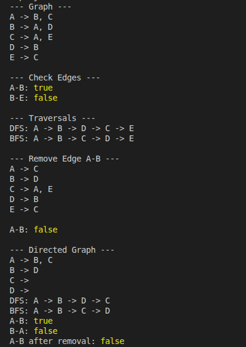

# Graph Implementation in JavaScript

This project implements a graph data structure in JavaScript using an adjacency list. It supports both directed and undirected graphs and demonstrates fundamental graph operations and traversal algorithms.

## Features

- **Add Edges:** Connect vertices in the graph.
- **Remove Edges:** Remove connections between vertices.
- **Check Edges:** Check whether an edge exists between two vertices.
- **Print Graph:** Display the graph as an adjacency list.
- **Depth-First Search (DFS):** Traverse the graph by exploring as deeply as possible before backtracking.
- **Breadth-First Search (BFS):** Traverse the graph level by level.
- **Directed and Undirected Graphs:** Choose whether edges are one-way or bidirectional.

## Implementation

The graph is represented using an adjacency list, where each vertex stores a list of its neighboring vertices.

The `Graph` class includes the following methods:

| Method                         | Description                                     |
| ------------------------------ | ----------------------------------------------- |
| `addVertex(vertex)`            | Adds a vertex to the graph.                     |
| `addEdge(vertex1, vertex2)`    | Adds an edge between two vertices.              |
| `removeEdge(vertex1, vertex2)` | Removes an edge between two vertices.           |
| `hasEdge(vertex1, vertex2)`    | Checks whether an edge exists.                  |
| `printGraph()`                 | Prints the adjacency list.                      |
| `DFS(startVertex)`             | Traverses the graph using Depth-First Search.   |
| `BFS(startVertex)`             | Traverses the graph using Breadth-First Search. |

## Testing

The graph was tested in the terminal using Node.js.

The tests cover:

- Adding edges and displaying the adjacency list.
- Checking whether edges exist.
- Removing edges and verifying their removal.
- Performing DFS and BFS traversals from a starting vertex.
- Testing directed graph behavior.

### Terminal Test Results

The following screenshot shows the tests performed in the terminal.

